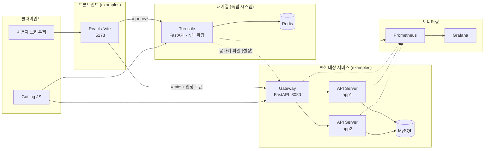
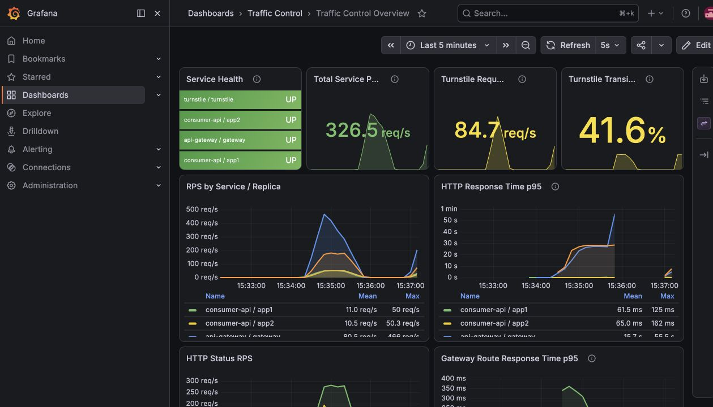

# Traffic Control System

> 티켓 오픈처럼 트래픽이 순간적으로 몰리는 상황에서 서버가 감당할 수 있는 사용자만 통과시키고, 나머지는 순서대로 기다렸다가 자동으로 입장시키는 콘서트 예매 데모입니다.



대기열(Turnstile)과 보호 대상 서비스는 서로를 호출하지 않습니다. 대기열은 입장 토큰을 서명해서 발급하고, Gateway는 대기열의 **공개키 파일만으로** 토큰을 검증합니다.

## 왜 필요한가요?

인기 공연의 예매가 시작되면 평소보다 훨씬 많은 요청이 몇 초 안에 몰립니다. 최근 열린 유명 아이돌의 예매 사이트에는 100만명이 넘는 사람들이 단시간 내에 몰리곤 했습니다.

모든 요청을 API와 데이터베이스에 그대로 전달하게 되면 응답이 느려지고, Time out과 새로고침이 겹치면서 정상 사용자까지 서비스를 이용하기 어려워집니다.

이 프로젝트는 서비스가 감당할 수 있는 만큼만 사용자를 입장시키고, 나머지는 실패시키는 대신 대기열에서 순서대로 기다리게 합니다.

- 사용자는 자신의 대기 순번을 확인할 수 있습니다.
- 차례가 되면 새로고침 없이 원래 화면으로 돌아갑니다.
- 운영자는 대기 인원과 입장 인원을 실시간으로 확인하고, 재배포 없이 입장 기준을 바꿀 수 있습니다.

## 바로 실행하기

```bash
git clone https://github.com/duffyishere/traffic-control-system.git
cd traffic-control-system
docker compose up --build -d
docker compose ps
```

서명 키는 첫 실행 때 `keygen` 서비스가 `turnstile/keys/`에 자동으로 만듭니다.

- 좌석 예매: http://localhost:5173
- 대기열 API 문서: http://localhost:8083/docs
- 운영 대시보드: http://localhost:3000
  - ID: `admin`
  - Password: `admin`

## 실행하면 무엇을 볼 수 있나요?

### 1. 좌석을 직접 예매할 수 있습니다

처음 실행하면 `S-0001`부터 `S-1000`까지 1,000개의 좌석이 준비됩니다.

1. 원하는 좌석을 선택합니다.
2. 예매자 이름을 입력하고 `예매 확정`을 누릅니다.
3. 예약 번호와 완료 메시지를 확인합니다.
4. 잠시 후 좌석 목록으로 돌아오면 해당 좌석이 `예약됨` 상태로 표시됩니다.

좌석을 초기화하려면 화면 상단의 `좌석 예매 초기화` 버튼을 통해 할 수 있습니다.

### 2. 혼잡하면 대기 순번이 표시됩니다

동시에 입장할 수 있는 인원이 차면 오류 화면 대신 대기 페이지(`/waiting`)로 이동합니다. 한산할 때는 대기 페이지를 거치지 않고 바로 입장합니다.

- 현재 대기 순번이 표시됩니다.
- 별도의 새로고침은 필요하지 않고, 새로고침하거나 새 탭을 열어도 순번이 유지됩니다.
- 입장이 허용되면 원래 페이지로 자동 복귀합니다.


### 3. 처리 상황을 대시보드에서 확인할 수 있습니다

Grafana에서 `Traffic Control Overview` 대시보드를 엽니다.

다음 변화를 실시간으로 확인할 수 있습니다.

- 각 서비스의 정상 동작 여부
- 전체 요청 처리량
- 대기열 진입·입장·이탈 이벤트 비율
- Gateway가 거절한 요청 비율 (토큰 없음 401, 토큰별 한도 초과 429)
- 현재 입장해 있는 사용자 수와 대기 중인 사용자 수
- 응답시간과 CPU, 메모리



## 트래픽 직접 만들어 보기

트래픽 발생기는 애플리케이션 컨테이너와 분리해서 실행하는 것을 권장합니다.

Node.js와 npm이 필요합니다. 최초 한 번 의존성을 설치합니다.

```bash
cd examples/web-client
npm ci
```

이후 로컬에서 Gatling을 실행합니다.

```bash
./node_modules/.bin/gatling run
```

부하 조건과 대상 주소(`baseUrl`=Gateway, `queueBaseUrl`=Turnstile) 등 실행 설정은 `src/basicSimulation.gatling.js`에서 관리합니다.

테스트 중 시크릿 창에서 http://localhost:5173 을 열거나 기존 좌석 페이지를 새로고침하면 다음 흐름을 확인할 수 있습니다.

1. 입장 인원이 `MAX_ACTIVE_USERS`에 도달합니다.
2. 브라우저가 대기 페이지로 이동합니다.
3. 현재 순번이 표시됩니다.
4. 앞사람이 예매를 마치거나 떠나 자리가 나면 자동으로 좌석 페이지에 입장합니다.
5. Grafana의 대기 인원은 증가했다가 다시 줄어듭니다.

테스트가 끝나면 터미널에 Gatling HTML 리포트 경로가 표시됩니다. 리포트는 기본적으로 `examples/web-client/target/gatling/` 아래에 생성됩니다.

> 정확한 성능을 측정하려면 애플리케이션과 다른 머신에서 부하 테스트를 실행하는 것이 좋습니다.

## 내부 동작

1. 브라우저는 API를 호출하기 전에 대기열에 진입합니다(`POST /queue/enter`). 대기표(ticket)는 쿠키로 받습니다.
2. 자리가 있으면 바로, 없으면 차례가 왔을 때 입장 토큰(ES256 JWT)을 받습니다. 대기 중에는 서버가 알려 준 간격으로 순번을 확인합니다(`GET /queue/status`).
3. 브라우저는 토큰을 `Authorization` 헤더에 담아 API를 호출합니다. Gateway는 공개키로 토큰을 검증하고, 토큰이 없거나 무효하면 401을 돌려줍니다.
4. 입장한 동안 20초마다 세션을 연장합니다(`POST /queue/refresh`). 연장이 멈추면 60초 안에 자리가 회수됩니다.
5. 예매를 마치면 자리를 바로 반납합니다(`POST /queue/leave`).

입장 기준은 **동시 입장 인원**(`MAX_ACTIVE_USERS`)과 **초당 입장 수**(`ADMIT_RATE_PER_SEC`)입니다. 운영 중에는 재배포 없이 바꿀 수 있습니다.

```bash
# docker-compose.yml에서 TURNSTILE_ADMIN_TOKEN을 설정한 경우
curl -X PUT http://localhost:8083/admin/config \
  -H "Authorization: Bearer $TURNSTILE_ADMIN_TOKEN" -H "Content-Type: application/json" \
  -d '{"max_active": 500, "admit_rate": 50}'   # state: open | paused | closed
```

대기열 서버는 상태를 전부 Redis에 두기 때문에 여러 대로 늘릴 수 있습니다.
로컬 compose는 host 포트 8083을 고정하므로 한 대만 띄웁니다. 여러 대로 운영할 때는 앞단에 로드밸런서를 둡니다.

## 프로젝트 구조

| 경로 | 설명 |
|---|---|
| `turnstile/` | 대기열 서버. 연결된 시스템을 모르는 독립 서비스 |
| `examples/gateway/` | 입장 토큰을 검증하는 API Gateway 예시 |
| `examples/api-server/` | 좌석 조회·예매 API 예시 |
| `examples/web-client/` | 대기열과 API를 잇는 React 클라이언트, Gatling 부하 시나리오 |

## 기술 구성

- Python 3.13, FastAPI, httpx
- Redis(Lua), MySQL
- React, Vite
- Prometheus, Grafana
- Docker Compose

## 종료하기

```bash
docker compose down
```
