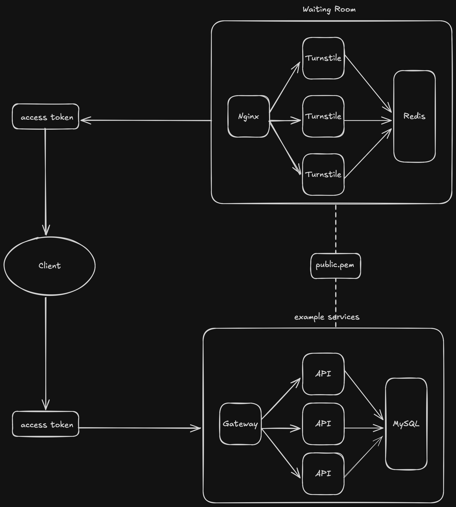

# Turnstile

Turnstile은 서비스 앞에 붙여서 쓰는 독립형 대기열입니다. 서버를 늘리지 않아도 기존보다 60배 이상 많은 사용자가 몰릴 때 서비스가 멈추지 않습니다.

티켓 오픈처럼 요청이 한꺼번에 몰리면 API 서버는 한계를 넘는 순간 처리량이 오히려 떨어집니다. 그러면 정상 사용자까지 서비스를 쓸 수 없게 됩니다. Turnstile은 서비스가 감당할 수 있는 만큼만 사용자를 들여보냅니다. 나머지 사용자는 실패하는 대신 순서를 기다리다가 차례가 되면 자동으로 입장합니다.

서비스 코드는 고칠 필요가 없습니다. 대기열과 서비스는 서로를 호출하지 않습니다. Turnstile이 서명한 입장 토큰을 서비스 앞단의 Gateway가 공개키 파일 하나로 검증하면 됩니다.



# 성능

> 환경: Mac · Docker Desktop(4 vCPU) · gateway 1 + API 서버 2 + MySQL · Locust
> 시나리오: 방문자가 입장 토큰으로 좌석 조회, 단계별 마지막 60초 평균

```mermaid
%%{init: {"themeVariables": {"xyChart": {"plotColorPalette": "#e5484d, #30a46c"}}}}%%
xychart-beta
    title "동시에 감당한 사용자 수 (명)"
    x-axis ["대기열 없음: 250명", "대기열 사용: 15,000명"]
    y-axis "명" 0 --> 16000
    bar [250, 0]
    bar [0, 15000]
```



|                |         동시 사용자 | 한계를 넘으면                                                              |
| -------------- | ------------------: | -------------------------------------------------------------------------- |
| 🔴 대기열 없음 |           **250명** | 300명부터 gateway CPU 포화(104%), 처리량 113 → 93건/초로 붕괴, p99 3~4.5초 |
| 🟢 대기열 사용 | **15,000명 (60배)** | API 서버에는 초당 60명만 입장시켜 안정 유지, API 서버 p99 110ms 이하       |

# 빠르게 사용해보기

# 내 서비스와 연동하기

```bash
docker compose up --build -d
```

서명 키는 첫 실행 때 `turnstile/keys/`에 자동으로 만들어집니다.

| 주소                       | 내용            |
| -------------------------- | --------------- |
| http://localhost:5173      | 좌석 예매 데모  |
| http://localhost:8083/docs | 대기열 API 문서 |

## 내 서비스에 붙이기

### 1. 서버: Gateway가 내 서비스를 가리키게 합니다

`docker-compose.yml`에서 `UPSTREAMS`만 내 서비스 주소로 바꿉니다. 서비스 코드는 고칠 필요가 없습니다.

```yaml
gateway:
  environment:
    UPSTREAMS: http://my-service:8080
```

Gateway는 입장 토큰을 공개키(`turnstile/keys/public/public.pem`)로 검증한 뒤 요청을 넘깁니다. 이미 쓰는 Gateway가 있다면, 그곳에서 같은 공개키로 토큰을 검증하기만 하면 됩니다. (ES256 · aud `turnstile:access` · iss `turnstile`)

### 2. 클라이언트: 대기열을 거쳐 들어옵니다

| 순서 | 요청                  | 하는 일                                                              |
| :--: | --------------------- | -------------------------------------------------------------------- |
|  1   | `POST /queue/enter`   | 자리가 있으면 `ALLOWED`와 토큰을, 없으면 `WAITING`과 순번을 받습니다 |
|  2   | `GET /queue/status`   | `WAITING`이면 `retryAfterMs` 뒤에 다시 확인합니다                    |
|  3   | 서비스 API            | `Authorization: Bearer <token>`을 붙여 Gateway로 보냅니다            |
|  4   | `POST /queue/refresh` | 머무는 동안 `refreshAfterMs`마다 호출해 토큰을 갱신합니다            |
|  5   | `POST /queue/leave`   | 다 쓰면 자리를 반납합니다                                            |

대기 순번은 쿠키에 저장되어 새로고침해도 사라지지 않습니다. 구현 예시는 `examples/web-client`에 있습니다.

## 운영 중 설정 바꾸기

관리 토큰을 정해서 실행하면, 재배포 없이 입장 기준을 바꿀 수 있습니다. 바뀐 값은 모든 대기열 서버에 바로 반영됩니다.

```bash
TURNSTILE_ADMIN_TOKEN=secret docker compose up -d

curl -X PUT localhost:8083/admin/config \
  -H "Authorization: Bearer secret" \
  -H "Content-Type: application/json" \
  -d '{"admit_rate": 100, "max_active": 5000}'
```

| 항목          | 의미                                                                     | 기본값 |
| ------------- | ------------------------------------------------------------------------ | -----: |
| `admit_rate`  | 초당 입장 인원                                                           |     60 |
| `max_active`  | 동시에 입장해 있을 수 있는 인원                                          |  3,000 |
| `max_waiting` | 최대 대기 인원                                                           | 70,000 |
| `state`       | `open` 정상 운영 · `paused` 대기만 받고 입장 멈춤 · `closed` 대기열 닫음 | `open` |

## 대기열 서버 늘리기

```bash
docker compose up -d --scale turnstile=5
docker compose restart turnstile-lb
```

대수를 바꾼 뒤에는 `turnstile-lb`를 재시작해야 새 서버로도 요청이 나뉩니다.
